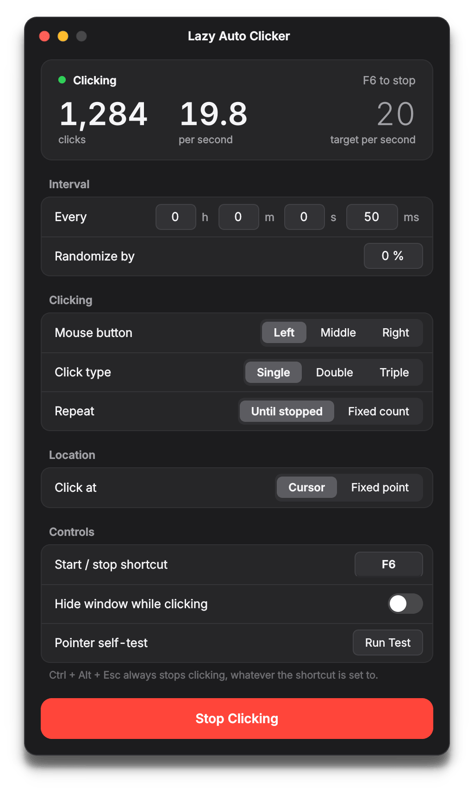

<div align="center">


# Lazy Auto Clicker

**A precision auto clicker for Linux, built for Wayland first.**

Set an interval, pick a button, press a hotkey and walk away.<br>
Works in native Wayland apps, XWayland, games and browsers alike.

[](https://github.com/devbnkdr/LazyAutoClicker/actions/workflows/release.yml)
[](https://github.com/devbnkdr/LazyAutoClicker/releases/latest)
[](LICENSE)


<br>

<picture>
  <source media="(prefers-color-scheme: dark)" srcset="docs/screenshot-dark.png">
  <source media="(prefers-color-scheme: light)" srcset="docs/screenshot-light.png">
  
</picture>

</div>

<br>

## Highlights

- **Works under Wayland.** Clicks are generated by the kernel, not by X11, so
  KWin, Mutter and Hyprland all accept them.
- **Global hotkey.** Start and stop from anywhere with F6 or any combination you
  choose. **Ctrl + Alt + Esc** always stops.
- **Precise timing.** Hours down to milliseconds, with optional random variation
  so clicks don't land on a perfectly regular beat.
- **Any button, any rhythm.** Left, middle or right; single, double or triple;
  run forever or stop after a set count.
- **Click where you want.** Follow the cursor, or pin clicks to a fixed point
  picked with an on-screen crosshair.
- **Looks right on your desktop.** Follows your light or dark appearance
  automatically, and keeps running from the tray.
- **One file.** Ships as a single self-contained executable, so the machine
  running it needs no Python installed.

## Install

### From a release

1. Download the latest `lazyautoclicker-*-linux-x86_64.tar.gz` from
   [Releases](https://github.com/devbnkdr/LazyAutoClicker/releases/latest).
2. Unpack it and run the installer:

   ```sh
   tar -xzf lazyautoclicker-*-linux-x86_64.tar.gz
   cd lazyautoclicker-*-linux-x86_64
   ./install.sh
   ```

3. **Log out and back in.** The `input` group membership only takes effect in a
   new session.

`install.sh` asks for sudo once to set up input permissions (see below), then
installs the binary to `~/.local/bin`, the icon to the hicolor theme, and a
launcher in your application menu and on your desktop.

### From source

On Arch / CachyOS:

```sh
sudo pacman -S --needed pyside6 python-evdev
./build.sh
./install.sh
```

On other distributions, `build.sh` pulls PySide6 and evdev from PyPI into a private
build environment, so you only need `python3` with `venv`.

`build.sh` produces `dist/lazyautoclicker`, a single executable of about 90 MB.

<details>
<summary><b>Tips</b></summary>

- If `~/.local/bin` isn't on your `PATH`, add it. In fish: `fish_add_path ~/.local/bin`
- Plasma 6 won't launch a desktop file it doesn't trust. If the desktop icon does
  nothing, right-click it and allow it to run.

</details>

## Using it

| Section | What it does |
| --- | --- |
| **Dashboard** | Live click count, actual clicks per second, and the target rate your interval works out to. |
| **Interval** | Hours, minutes, seconds and milliseconds, added together. *Randomize by* varies each interval by up to that percentage. |
| **Clicking** | Mouse button, single/double/triple click, and whether to run until stopped or for a fixed count. |
| **Location** | *Cursor* clicks wherever the pointer is, which is the most reliable mode. *Fixed point* uses a virtual absolute-positioning device: choose a spot with **Pick…**, then press **Test** to confirm your compositor honours it. |
| **Controls** | Click the shortcut keycap and press a new combination to change it. *Hide window while clicking* tucks the app into the tray during a run. *Pointer self-test* traces a small square with your cursor to prove the backend works. |

Settings are saved to `~/.config/lazyautoclicker/settings.json`.

### Command-line options

```
lazyautoclicker [--native-frame] [--theme light|dark] [--version] [--help]
```

| Option | Effect |
| --- | --- |
| `--native-frame` | Use your compositor's titlebar instead of the built-in one. |
| `--theme light\|dark` | Force a colour scheme instead of following the system. |

## How it works

Most Linux auto clickers rely on XTest, which Wayland compositors don't accept.
Lazy Auto Clicker works at the kernel input layer instead:

- **Clicks out:** it creates a virtual mouse through `/dev/uinput`. The compositor
  sees a real input device and handles its clicks like any other mouse.
- **Hotkey in:** it reads key events directly from `/dev/input/event*`, so the
  shortcut works even when the window is hidden and another app has focus.

Both need a one-time permission setup, which `install.sh` handles:

| Change | Purpose |
| --- | --- |
| `modprobe uinput` + `/etc/modules-load.d/uinput.conf` | Makes `/dev/uinput` exist at boot |
| `/etc/udev/rules.d/99-lazyautoclicker.rules` | Gives group `input` read/write access to `/dev/uinput` |
| `gpasswd -a $USER input` | Adds you to that group |

To run only this step: `sudo ./install.sh --permissions-only`

> [!IMPORTANT]
> Membership of the `input` group lets **any** program running as you read every
> keystroke on the system. That's what a global hotkey costs under Wayland, and
> ydotool and similar tools ask for the same thing. If you'd rather not, skip the
> group and start and stop with the in-window button. Lazy Auto Clicker detects the
> missing access and turns the hotkey off instead of failing.

## Troubleshooting

<details>
<summary><b>"Input access is not set up"</b></summary>

Either the udev rule hasn't been applied or you haven't started a new session yet.
`ls -l /dev/uinput` should show `crw-rw---- root input`, and `id -nG` should list
`input`.

</details>

<details>
<summary><b>Clicks do nothing in one particular app</b></summary>

Some games take exclusive control of the pointer. Try windowed mode. If that
doesn't help, increase `hold_ms` in the settings file, because a few engines
ignore presses shorter than one frame.

</details>

<details>
<summary><b>Fixed point lands in the wrong place</b></summary>

Coordinates are measured across the whole virtual desktop: one rectangle that
starts at the top-left corner of the leftmost screen. If **Test** doesn't move the
pointer at all, your compositor is ignoring the absolute device. Use cursor mode
instead.

</details>

<details>
<summary><b>The hotkey does nothing</b></summary>

Keyboards connected after Lazy Auto Clicker starts aren't detected. Restart the app.

</details>

## Development

```sh
python3 lazyautoclicker.py                                   # run from source
QT_SCALE_FACTOR=2 python3 tools/screenshot.py          # regenerate docs/ screenshots
```

To publish a release, bump `VERSION` in `lazyautoclicker.py`, add an entry to
[CHANGELOG.md](CHANGELOG.md), then push a matching tag (`git tag v1.2.0 && git push --tags`).
GitHub Actions builds the binary and attaches it to the release.

## Uninstall

```sh
./uninstall.sh
```

This removes the app, launcher and settings. The udev rule and group membership
stay in place because other tools may rely on them, and the script prints the
commands to remove them too.

## License

[MIT](LICENSE) © 2026 devbnkdr
